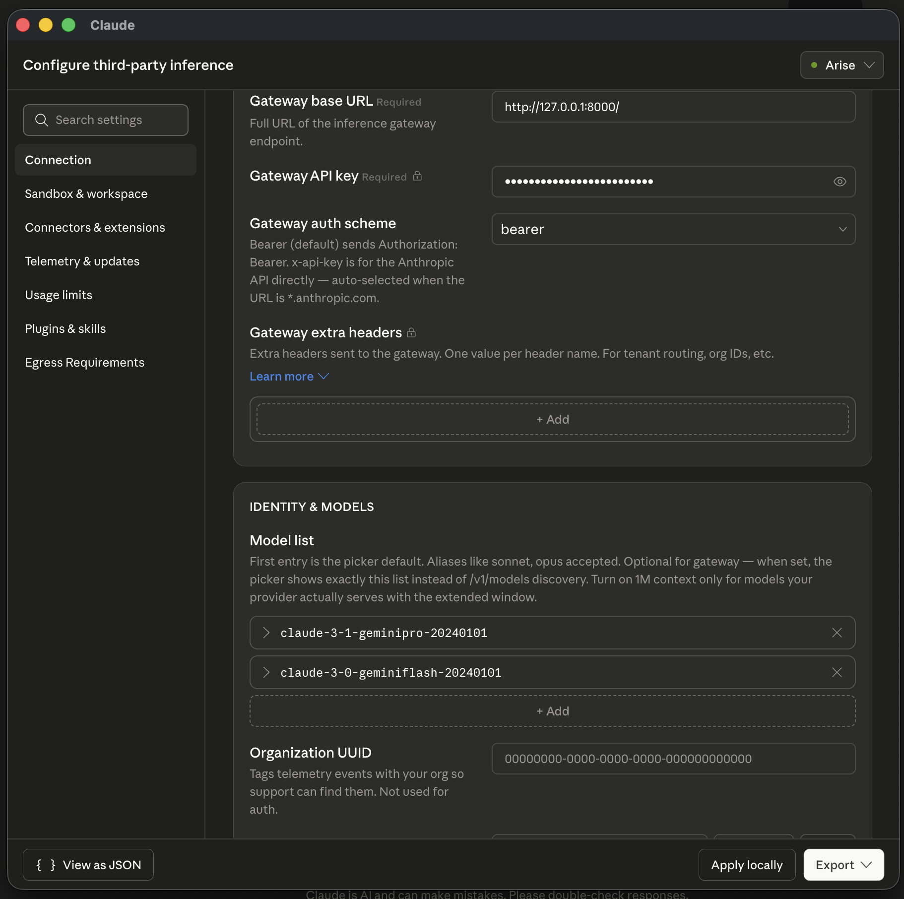

# Claude Desktop Proxy for LiteLLM

A high-performance reverse proxy written in Go that translates model IDs between [Claude Desktop](https://claude.ai/download) / [Claude Code](https://docs.anthropic.com/en/docs/agents-and-tools/claude-code/overview) and [LiteLLM](https://github.com/BerriAI/litellm) (or any OpenAI-compatible endpoint).

Specifically, this proxy intercepts requests and dynamically maps Anthropic's Claude model IDs to Google's Gemini model IDs, allowing you to seamlessly use Gemini models inside Claude's interfaces.

## Features

- **Blazing Fast**: Written in Go with minimal overhead.
- **In-flight Translation**: Dynamically rewrites incoming `/v1/messages` request payloads to use Gemini IDs.
- **Model Formatting**: Intercepts `/v1/models` responses to format and inject Claude-compatible aliases so they correctly populate in Claude's UI.
- **Production-Ready**: Includes request logging, panic recovery middlewares, and graceful shutdown handling.
- **Flexible Configuration**: `config.yaml` file, environment variables, and CLI flags — in increasing priority order.

## Prerequisites

- [Go 1.21+](https://golang.org/dl/)

## Installation

Clone the repository and build the binary:

```bash
git clone git@github.com:misternay/claude-desktop-proxy-litellm.git
cd claude-desktop-proxy-litellm

go mod tidy
go build -o proxy
```

## Configuration

Create a `config.yaml` file in the same directory as the executable (or use the provided one):

```yaml
target_url: "https://your-litellm-instance.com"
port: 8080
# Set to true only if your LiteLLM instance uses a self-signed certificate
insecure_skip_verify: false
```

### Configuration priority (highest wins)

| Source | Example |
| :--- | :--- |
| CLI flag | `--target`, `--port`, `--insecure` |
| Environment variable | `PROXY_TARGET_URL`, `PROXY_PORT` |
| `config.yaml` | `target_url`, `port`, `insecure_skip_verify` |

## Usage

1. Start the proxy server:

```bash
./proxy
```

You can also pass arguments directly:
```bash
./proxy --port 8000 --target https://your-litellm-instance.com
```

Or use environment variables (useful for containers):
```bash
PROXY_TARGET_URL=https://your-litellm-instance.com PROXY_PORT=8080 ./proxy
```

### Claude Desktop Integration

To connect the Claude Desktop application to this proxy, follow these steps to configure the inference gateway:



1. Open Claude Desktop settings and navigate to **Connection**.
2. Set the **Gateway base URL** to your proxy address (e.g., `http://127.0.0.1:8080/`). Note the trailing slash!
3. Add your LiteLLM/OpenAI key in the **Gateway API key** field.
4. Set the **Gateway auth scheme** to `bearer`.
5. Under **Model list**, add the fake Claude aliases so they populate in the UI:
   - `claude-2-5-geminipro-20240101`
   - `claude-2-5-geminiflash-20240101`
   - `claude-2-5-geminiflashlite-20240101`
   - `claude-3-1-geminipro-20240101`
   - `claude-3-0-geminiflash-20240101`

### Claude Code Integration

Set two environment variables before running Claude Code — no custom model name needed, the proxy automatically maps Claude's default model names to Gemini equivalents:

```bash
export ANTHROPIC_BASE_URL=http://127.0.0.1:8080/
export ANTHROPIC_API_KEY=<your-litellm-key>
claude
```

## Model Mappings

The proxy automatically maps model IDs in both directions. It handles two sources of model names:

### Claude Desktop aliases (manually added to the model list)

| Claude UI ID | Upstream Gemini Model |
| :--- | :--- |
| `claude-2-5-geminiflash-20240101` | `gemini-2.5-flash` |
| `claude-2-5-geminipro-20240101` | `gemini-2.5-pro` |
| `claude-2-5-geminiflashlite-20240101` | `gemini-2.5-flash-lite` |
| `claude-3-1-geminipro-20240101` | `gemini-3.1-pro` |
| `claude-3-0-geminiflash-20240101` | `gemini-3-flash` |

### Real Claude model names (sent automatically by Claude Code)

| Claude Code Model | Upstream Gemini Model |
| :--- | :--- |
| `claude-opus-4-5`, `claude-opus-4`, `claude-3-opus-20240229` | `gemini-2.5-pro` |
| `claude-sonnet-4-5`, `claude-sonnet-4`, `claude-3-5-sonnet-20241022`, `claude-3-5-sonnet-20240620`, `claude-3-sonnet-20240229` | `gemini-2.5-flash` |
| `claude-haiku-4-5`, `claude-haiku-4`, `claude-3-haiku-20240307` | `gemini-2.5-flash-lite` |

*Other unknown model IDs dynamically get a `claude-3-0-{id}-20240101` alias format.*
